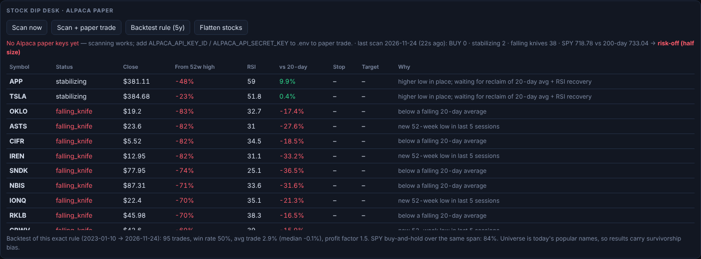

# Trading Command Center (TCC)

An autonomous, always-on station that runs **clusters of Freqtrade and Hummingbot bots**.
Behind them sit a mass strategy-research pipeline, a layered risk engine, AI agents
(Claude / Grok / rules), and a control-panel dashboard.

- **Research**: a genetic search tests thousands of strategy variants per cycle with a
  numba-compiled screener (≈120k per hour on 3 cores). It validates them with walk-forward
  folds, a held-out out-of-sample window and the **Deflated Sharpe Ratio**, then confirms
  survivors in Freqtrade's exact backtester. Hummingbot V2 controllers are researched in parallel.
- **Clusters**: each validated strategy runs as its own supervised Freqtrade bot (own port,
  DB and log). Hummingbot nodes run headless on paper connectors. Crashed bots restart
  automatically with backoff.
- **Risk**: kill switch, portfolio drawdown limit, daily loss halt, per-bot retire, losing-streak
  pause, exposure cap, plus Freqtrade's native protections inside every bot. AI agents can
  only tighten these limits.
- **AI agents**: the Research Director steers the search, the Risk Officer tightens limits, and
  the Portfolio Manager promotes and retires paper bots. Every decision is logged.
- **Dashboard**: `http://127.0.0.1:8800` shows equity, bots, the research funnel,
  the leaderboard, agent decisions, events and the kill switch.

See [`docs/SPEC.md`](docs/SPEC.md) for the architecture and [`docs/RESEARCH.md`](docs/RESEARCH.md)
for the sourced market and tooling research behind the design.

## Quick start

```bash
bash command_center/scripts/install.sh     # freqtrade + tcc, Hummingbot fork, data, tests
cd command_center
cp .env.example .env                       # optional: ANTHROPIC_API_KEY / XAI_API_KEY / TCC_API_TOKEN
../.venv/bin/tcc up                        # station + dashboard on http://127.0.0.1:8800
```

Other commands:

```bash
tcc research                # run one full research cycle now
tcc leaderboard             # validated strategies
tcc status                  # risk + bots summary
tcc kill / tcc reset-kill   # emergency stop
tcc plan --capital 20       # what a small account can actually do
```

## Stock dip desk (Alpaca paper)



- **What it does:** scans your watchlist once per trading day after the close (`station.yaml → stocks.universe`). It separates **stabilizing dips** from **falling knives**:

  | Status | Meaning |
  |---|---|
  | BUY | 15%+ below the 52-week high, no new low in 5 sessions, a higher low, back above the 20-day average, RSI recovered from oversold |
  | stabilizing | the higher low is in place, but no BUY confirmation yet |
  | falling knife | a new 52-week low in the last 5 sessions, or below a falling 20-day average |
  | excluded | under $5, under $20M/day traded, or a leveraged/inverse ETF |

- **Orders:** BUY signals become **Alpaca paper bracket orders**: market entry, a stop below the swing low and a target at 2× the risk.
- **Sizing:** 1% of equity at risk per trade, halved when SPY is below its 200-day average. At most 10% per position and 8 positions.
- **Exits:** positions are closed after 20 sessions.
- **Safeguards:** the station kill switch also flattens all stock positions. New entries stop if paper equity falls 10% from its peak.
- **Paper only:** the code only talks to `paper-api.alpaca.markets`.
- **Setup:** create a free account at alpaca.markets → Paper Trading → API Keys. Put `ALPACA_API_KEY_ID` and `ALPACA_API_SECRET_KEY` in `.env`.
- **Commands:**
  - `tcc dips scan`, `tcc dips trade`, `tcc dips backtest`, `tcc dips status`, `tcc dips flatten`
  - or the buttons on the dashboard

**Backtest of this exact rule** (2023–2026, 46 names):

| Metric | Value |
|---|---|
| Trades | 95 |
| Win rate | 50% |
| Average trade | +2.9% (median −0.1%) |
| Profit factor | 1.5 |
| By year | 2023 +3.8%, 2024 +8.4%, 2025 +1.5%, 2026 **−2.3%** |
| SPY buy-and-hold, same span | +84% |

The universe is today's popular names, so these results carry survivorship bias. Treat the desk as a timing filter to test on paper, not proof of an edge.

## Run it 24/7

The station only trades while the machine it's on is awake and online. Pick one:

| Where | Good for | Watch out for |
|---|---|---|
| Your desktop + Docker Desktop | starting out, paper trading | sleep/hibernate, Windows updates and reboots pause everything |
| A small cloud VM (2 vCPU / 4 GB, ~$10-25/mo) | real 24/7, live money | pick a region your exchange allows; keep the API on localhost/Tailscale |
| Linux box with systemd (`deploy/tcc.service`) | home server / VPS without Docker | — |

### Docker (desktop or VM)

```bash
git clone -b claude/happy-tesla-r72guz https://github.com/Army161/freqtrade
cd freqtrade/command_center
cp .env.example .env            # put your keys in HERE, never in chat or git
docker compose up -d --build    # first build ~10-15 min (compiles Hummingbot)
docker compose logs -f          # first start downloads ~2 years of market data
```

Then open http://localhost:8800.

- `restart: unless-stopped` restarts the container after crashes, and after reboots once Docker is running.
- On a desktop, turn on Docker Desktop → Settings → General → **Start Docker Desktop when you sign in**.
- Also set your OS power settings to **never sleep**.
- State (DB, bot trade history) and market data live in Docker volumes and survive rebuilds.
- Update: `git pull && docker compose up -d --build`.
- Stop: `docker compose down`. Your volumes are kept; only `down -v` deletes them.

The orchestrator supervises (and restarts) every bot, and Docker or systemd supervises the orchestrator.

## Going live (read this first)

Paper trading is the default. Live trading needs **all** of the following:

- `station.mode: live` in `station.yaml`
- `TCC_LIVE=1` in the environment
- exchange keys in `.env`

Use a sub-account with withdrawals disabled. Only strategies you explicitly deploy get real
money; agents never promote to live.

**Expectations with $20:**
- Exchange minimum orders are about $5, so you can hold about 3 positions at once.
- Fees and spread are a large share of each trade.
- Running many bots in parallel only makes sense in paper mode at this size.

No configuration of this system, or any other, can promise "$20 → thousands in days".
Regulators (CFTC, SEC, FCA) explicitly warn that such claims are a hallmark of fraud. See `docs/RESEARCH.md` §4.

The honest value of TCC is:
- finding out cheaply whether a strategy has a real, out-of-sample edge;
- running the ones that do under strict risk controls;
- killing them fast when they stop working.

## Layout

```
command_center/
  station.yaml           station config (pairs, clusters, risk, agents)
  tcc/research/          genome, indicators, numba screener, validation (DSR), evolution, ft_confirm
  tcc/clusters/          Freqtrade cluster + config builder, Hummingbot research + headless nodes
  tcc/risk/              risk engine, sizing
  tcc/agents/            providers (Claude/Grok/rules) + agent crew
  tcc/orchestrator.py    async loops; tcc/api/server.py REST; tcc/dashboard/index.html
  workers/hb_backtest.py runs inside the Hummingbot venv
  tests/                 pytest suite
../user_data/strategies/TCCGenome.py   the single Freqtrade strategy that runs any genome
```
